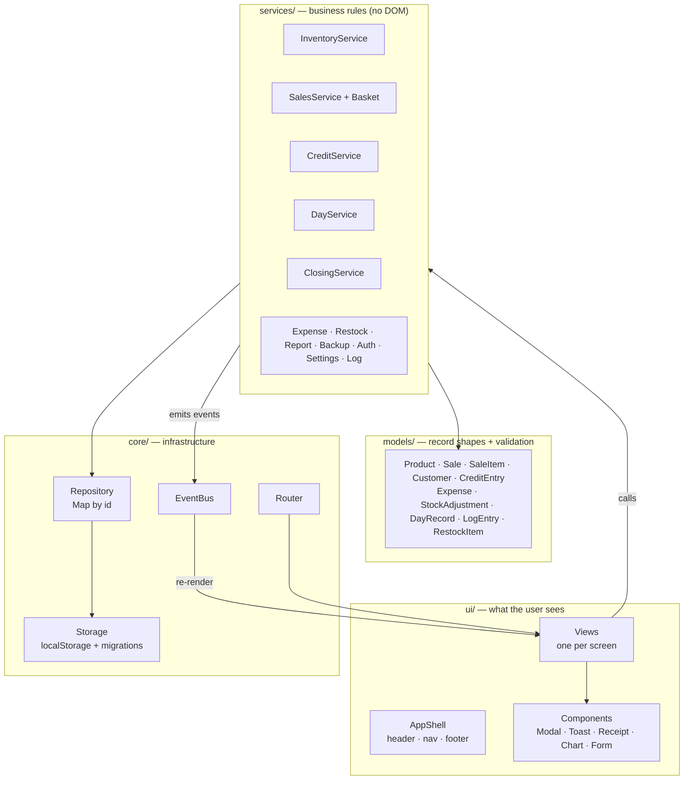
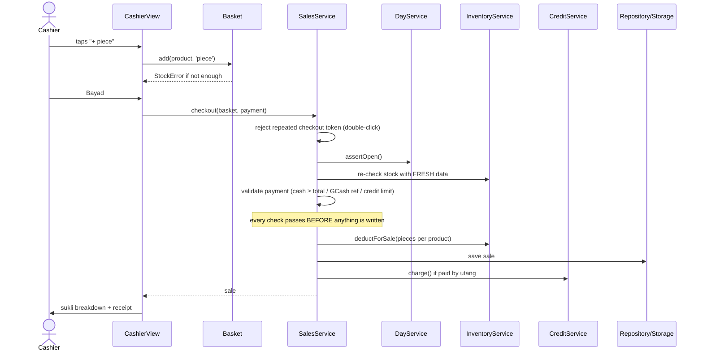
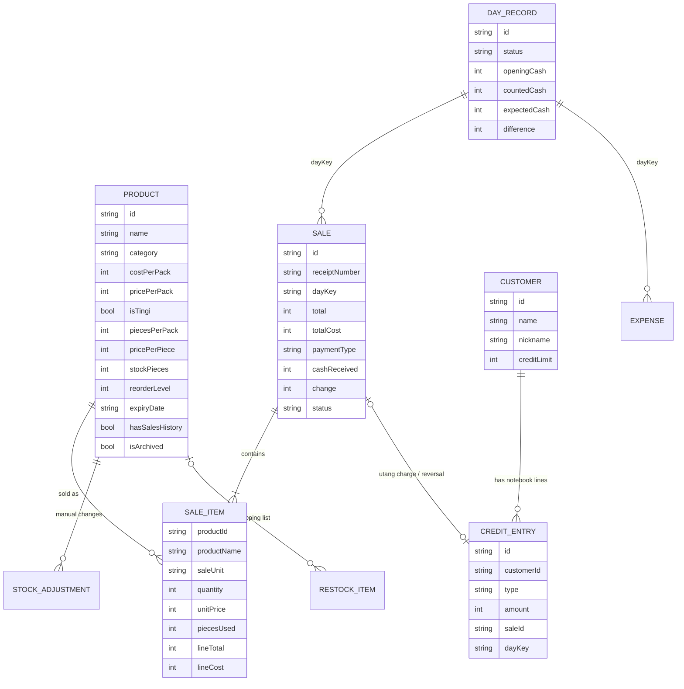

# Architecture

## 1. Layers

Tindahan is split into layers. Each layer only talks to the layer directly below it.

| Layer | Folder | Rule |
|---|---|---|
| UI | `js/ui/` | Builds DOM, reads forms, shows errors. **Never** contains business rules. |
| Services | `js/services/` | All rules (stock checks, credit limits, cash count). **Never** touches the DOM, so every rule can be tested in Node. |
| Models | `js/models/` | Creates and validates one kind of record. Pure functions. |
| Core | `js/core/` | Saving, loading, events, routing, error types. Knows nothing about sari-sari stores. |
| Utils | `js/utils/` | Small pure helpers (money, dates, validators, CSV, i18n). |

### Why services never touch the DOM
Separating them means the same `SalesService.checkout()` can be called by the cashier screen, by the demo data generator and by the tests. If a service built HTML, it could only be tested in a browser, and a change to the design could break business rules.

### Dependency injection
`js/app/createApp.js` is the only place where objects are created and connected. Each service receives what it needs through its constructor. For tests, `createApp({ storage: new Storage(new MemoryBackend()), clock: createFixedClock('2026-11-22') })` gives a complete app with no browser and a fixed date.

### Events
After any change, a service calls `announce()` (in `BaseService`). This writes an activity-log entry and emits `data:changed`. Every mounted view listens and re-renders. Views batch several events into one render with `queueMicrotask`.

---

## 2. Data flow of a sale

---

## 3. Data model

All money is an **integer number of centavos**. All stock is an **integer number of pieces**.

Storage keys (all prefixed with `tindahan:`): `products`, `sales`, `customers`, `creditEntries`, `expenses`, `stockAdjustments`, `days`, `restockItems`, `logEntries`, `settings`, `categories`, `counters`, `auth`, `schemaVersion`.

---

## 4. Key design decisions

| Decision | Why |
|---|---|
| **Money in centavos** | `0.1 + 0.2 !== 0.3` in JavaScript. Integer centavos are exact, so the end-of-day cash count never drifts. Input like `"1.15"` is parsed by splitting on the dot, not by multiplying by 100. |
| **Selling prices are multiples of 25¢** | The smallest coin a cashier can hand back is 25 sentimo. Enforcing this guarantees exact change. |
| **Stock in pieces** | A 10-piece pack sold one at a time would otherwise leave 9.9 packs. Packs are derived for display (`3 packs + 5 pcs`). |
| **Pack size locked while stock > 0** | If a 10-piece tingi item stopped being tingi, 30 stored pieces would silently become 30 packs. |
| **Snapshots in SaleItem** | Old receipts and reports must show the name and price at the time of sale, even after edits. |
| **Archive, don't delete** | Products and suki with history are hidden, not removed, so old sales and notebooks still make sense. |
| **Sales belong to the open day, not the calendar date** | A sale at 12:15 AM is still part of the drawer that opened that morning. Local date keys are used instead of `toISOString()`, which would shift Manila evenings into the next UTC day. |
| **Greedy change-making** | The PH denominations (1-2-5 pattern) form a *canonical* coin system, where taking the largest piece that fits is always optimal. A test proves it against dynamic programming for every amount up to ₱2,000. |
| **FIFO utang** | A payment settles the oldest utang first. This gives the "days unpaid" used for overdue warnings and the hand-drawn strikethrough in the notebook. |
| **Utang balance is computed, never stored** | The balance is the sum of the notebook lines, so it can never disagree with them. |
| **Check everything, then write** | `checkout()` and `deductForSale()` validate all items before changing any data, so a failure never leaves a half-finished sale. |
| **Checkout token** | Each basket gets a one-time token. A double-clicked "Bayad" is rejected the second time. |
| **Repository with `Map`** | O(1) lookups by id. On a failed save (storage full), the change is rolled back in memory too. |
| **Reports in one pass** | Each report walks the sales once and adds into buckets found by key, instead of filtering all sales per bucket. |
| **Restock formula** | `target = max(avg daily pieces × 7, reorderLevel × 2 packs, 1 pack)`, `suggestion = ceil((target − stock) / piecesPerPack)`. Fast sellers get a week's supply, and slow sellers get topped up. |
| **Expected cash** | `opening + cash sales + utang paid in cash − cash taken out`. Voided sales are excluded (their cash was returned). GCash and utang sales never enter the drawer. |
| **Net profit** | Only "store expense" cash-outs reduce profit. Owner withdrawals are the owner's take, and restock payments are already counted as cost of goods when the items sell. |
| **Schema version + migrations** | `Storage.migrate()` upgrades old saved data step by step when models change. |
| **Backup validation** | Every record of every collection is type-checked before anything is overwritten. Unknown sections are rejected. The PIN is never included. |
| **No `innerHTML` for user text** | `el()` sets `textContent`, so a product named `` is shown as text (XSS-safe). CSV export prefixes `= + - @` cells with `'` (formula injection). |
| **Demo data runs through the real services** | A throw-away in-memory copy of the app opens, sells and closes 30 days, and the result is imported like a backup. Demo data can never break a business rule. |

---

## 5. Error handling

1. **Models and services** throw typed errors (`ValidationError`, `StockError`, `CreditLimitError`, `StoreClosedError`, `ConflictError`, `StorageQuotaError`, `AuthError`). Each carries an i18n `messageKey` and the `field` it belongs to.
2. **Views** run actions through `BaseView.runAction()`. A typed error is shown under its field (or in the form's banner, or as a toast). Alerts are never used.
3. **Anything unexpected** reaches the global handler (`ui/errorHandler.js`, `window.onerror` + `unhandledrejection`), which logs the details and shows a friendly toast. The app never goes blank.
4. **Storage problems:** corrupted JSON is replaced with safe defaults and reported once on startup. If `localStorage` is blocked, the app runs in memory and warns the user.
